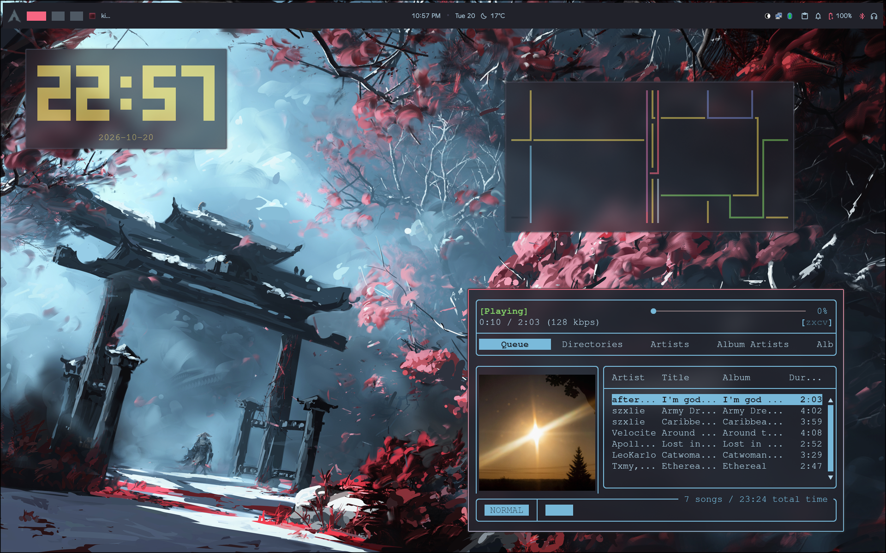

# Ricing-Arch




Ricing-Arch is a complete Arch Linux desktop rice repository designed to reproduce a cohesive, modern, and highly customized Hyprland-based environment. It bundles carefully tuned configurations for the shell, window manager, terminal, music player, application launcher, greeter, cursor theme, wallpapers, and helper utilities, allowing anyone to recreate the same polished desktop experience with a single installer. The repository follows a clear and familiar structure, separating dotfiles, wallpapers, icons, cursors, and scripts so that each component is easy to inspect, modify, or reuse independently.

At the core of the setup is a QuickShell-based bar and panel system, originally derived from DankMaterialShell but rebranded and adapted to work as a standalone QuickShell configuration. It integrates tightly with Hyprland, providing workspace management, focused application icons, media controls, system monitors, and a clean Material-inspired aesthetic. The Hyprland configuration includes sensible keybindings, window rules, autostart entries, cursor theming, and a screenshot shortcut using grim and slurp. Kitty is configured as the primary terminal, while MPD and rmpc provide a lightweight but powerful music experience. Vicinae is included as a fast application launcher with a complete Papirus icon theme to ensure consistent iconography across the desktop.

The repository also contains a greetd configuration for the DMS greeter, along with a helper script to synchronize the greeter with the current session wallpaper and theme. Wallpapers are included directly, and the cursor theme is packaged so it can be installed automatically. A comprehensive install script handles package installation, dotfile deployment, icon and cursor installation, wallpaper copying, tty-clock compilation, and PATH setup. The goal is not just to share configuration files, but to provide a reproducible and approachable rice that can be deployed on a fresh Arch Linux installation with minimal manual intervention, while still remaining flexible enough for further personalization and experimentation.

## Structure
- `dotfiles/` - configuration files
- `wallpapers/` - wallpapers
- `icons/` - icon themes
- `cursors/` - cursor themes
- `scripts/` - helper scripts, including `install.sh` and `sync-greeter.sh`

## Usage
Run the installer:

```bash
./scripts/install.sh
```

It installs required packages, backs up existing configs, copies dotfiles, and installs wallpapers, icons, cursors, tty-clock, and pipe. Log out and back in to apply.

## Terminal commands
Both `tty-clock` and `pipe` are installed into `~/.local/bin`, so you can run them straight from any terminal by typing:

```bash
tty-clock
pipe
```

`tty-clock` renders an animated clock in the terminal, and `pipe` runs the animated pipes screensaver.

To sync the greeter with your current wallpaper/theme:

```bash
./scripts/sync-greeter.sh
```
